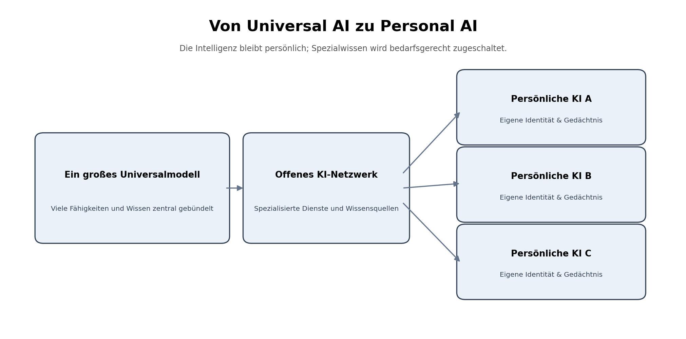

# 1. Vision: Von Universal AI zu Personal AI

## Kerngedanke

Die Zukunft der KI könnte sich von wenigen zentralen, universellen Großmodellen hin zu einer **Personalized AI Economy** entwickeln: Jeder Mensch besitzt eine eigene KI, die auf seine Bedürfnisse zugeschnitten ist und bei Bedarf auf ein Netzwerk spezialisierter KIs und Wissensdienste zugreift.

Die persönliche KI muss nicht alles selbst wissen. Sie muss gut denken, Aufgaben verstehen, Wissenslücken erkennen und die richtigen Quellen oder Experten finden.

## Das heutige Paradigma

Ein großes Modell versucht, möglichst viele Fähigkeiten und Wissensgebiete in einem System zu bündeln. Das kann leistungsfähig sein, bringt aber hohe Kosten, Ressourcenbedarf und Abhängigkeiten mit sich. Außerdem benötigt nicht jeder Nutzer dieselben Fähigkeiten.

## Das alternative Paradigma

- Kleine, leistungsfähige persönliche Basismodelle.
- Individuelle Persönlichkeit, Stimme und Bedienung.
- Modulare Wissens- und Fähigkeits-Erweiterungen.
- Externe Experten-KIs für Spezialfragen.
- Austauschbare Modelle und portables Gedächtnis.
- Lokaler Betrieb oder günstige Cloud-Ausführung.

## Leitthese

**Die KI der Zukunft ist nicht mehr nur ein Produkt, das jeder gleich benutzt. Sie ist ein persönliches digitales System, das sich mit seinem Besitzer entwickelt und bei Bedarf auf das Wissen anderer zugreift.**
