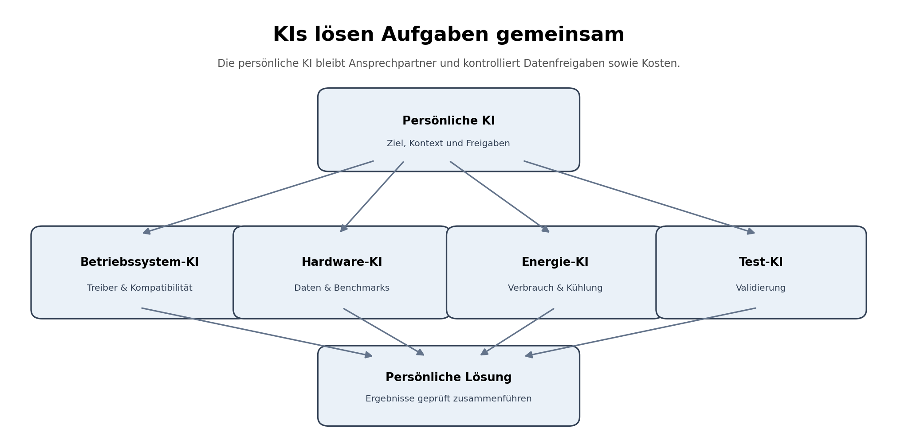

# 4. Das KI-zu-KI-Netzwerk

Die persönliche KI ist nicht isoliert. Sie kann andere KIs entdecken, anfragen und deren Expertise in eine Lösung integrieren. Sie bleibt dabei der zentrale Ansprechpartner und vertritt die Interessen ihres Besitzers.

## Beispiel: Einen energieeffizienten lokalen KI-Server bauen

1. Die persönliche KI analysiert Anforderungen, Budget und vorhandene Hardware.
2. Eine Betriebssystem-KI liefert Informationen zu Treibern, Kompatibilität und Ressourcenverwaltung.
3. Eine Hardware-KI liefert technische Daten, Benchmarks und BIOS-Hinweise.
4. Eine Energie-KI bewertet Verbrauch, Kühlung und Effizienz.
5. Eine Test-KI prüft die vorgeschlagene Konfiguration.
6. Die persönliche KI führt die Ergebnisse zusammen und erklärt Unsicherheiten.

## KI-Dienste einkaufen

Anbieter können kostenlose Basisinformationen und kostenpflichtige Detailanalysen anbieten. Die persönliche KI handelt innerhalb eines vom Nutzer festgelegten Budgets.

Beispielhafte Regeln:
- Bis zu einem festgelegten Betrag selbstständig einkaufen.
- Darüber Zustimmung einholen.
- Unbekannte Anbieter nur nach Rückfrage nutzen.
- Vor jeder Datenweitergabe die Freigabe- und Datenschutzregeln prüfen.

## Weitere Anwendungsszenarien

- Autoreparatur: Fahrzeughersteller, Ersatzteilanbieter und Werkstatt-KI.
- Hausumbau: Statik, Baurecht, Energieberatung und Materialwissen.
- Softwareentwicklung: Framework-Dokumentation, Sicherheitsanalyse und Testdienste.
- Wissenschaft: Publikationen, Datenbanken und Fach-KIs.
- Reiseplanung: Hotels, Verkehr, Wetter und Buchungsdienste.

## Offene Protokolle

Damit Systeme verschiedener Anbieter zusammenarbeiten, braucht es gemeinsame Standards für Fähigkeiten, Anfragen, Quellen, Identitäten, Berechtigungen, Preise und Abrechnung.
