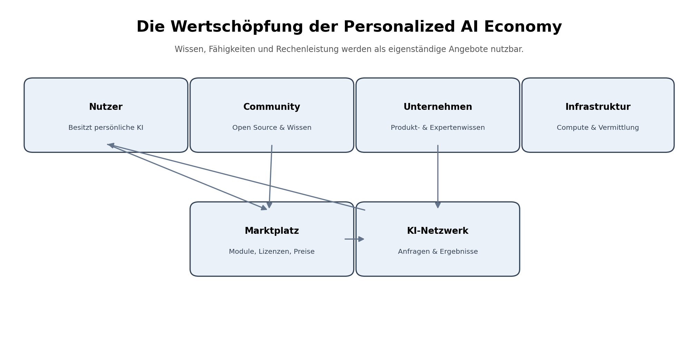

# 5. Wissensökonomie und Geschäftsmodelle

Unternehmen, Universitäten, Fachgemeinschaften und gemeinnützige Organisationen können ihr Wissen als KI-Dienst anbieten.

## Wikipedia als Beispiel

Eine Enzyklopädie könnte eine Wissens-KI bereitstellen, die strukturierte Inhalte, Quellen und Versionshistorie zugänglich macht. Ein kostenloser Zugang könnte durch Spenden und Community-Finanzierung getragen werden. Zusätzliche professionelle Dienste wären denkbar, ohne frei zugängliches Wissen grundsätzlich zu verdrängen.

## Hersteller als Experten

Ein Maschinenbauer könnte eine Hersteller-KI anbieten, die technische Zeichnungen, Komponenten, Ersatzteile, Wartungsintervalle, Fehlercodes und Firmware-Versionen kennt.

Mögliche Einnahmen:
- Premium-Support
- Diagnosen
- Wartungsplanung
- Optimierungsberatung
- Schulungen
- Ersatzteilvermittlung

## Warum Wissen dadurch wertvoller wird

Gut gepflegte Dokumentation kann direkt wirtschaftlichen Nutzen erzeugen. Anbieter konkurrieren nicht nur über ein möglichst großes Modell, sondern über Aktualität, Qualität, Verlässlichkeit und Spezialisierung ihrer Wissensdienste.

## Verteilte Wertschöpfung

Kleine Entwickler und Fachgemeinschaften können spezialisierte Module anbieten, ohne selbst ein universelles Großmodell entwickeln zu müssen.
