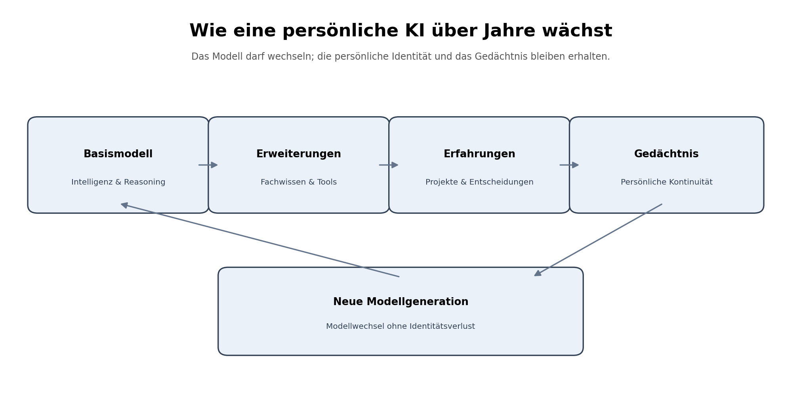

# 6. Entwicklung, Persönlichkeit und Gedächtnis

Die persönliche KI entwickelt sich durch drei Quellen: Basismodell, Erweiterungen und gemeinsame Erfahrungen.

## Drei Ebenen

1. **Basismodell:** grundlegende Intelligenz, Reasoning und Lernarchitektur.
2. **Erweiterungen:** Fachwissen, Werkzeuge und neue Tätigkeiten.
3. **Persönliches Gedächtnis:** Projekte, Präferenzen, Entscheidungen, Erfahrungen und Arbeitsweisen.

## Erinnern, Verstehen und Lernen

Diese Begriffe sollten technisch getrennt werden:

- **Erinnern:** relevante Informationen aus früheren Interaktionen speichern und abrufen.
- **Verstehen:** Zusammenhänge erkennen und Erfahrungen übertragen.
- **Lernen:** Verhalten oder Fähigkeiten kontrolliert verbessern.

## Modellwechsel ohne Identitätsverlust

Ein neues Basismodell sollte die vorhandene Identität nicht auslöschen. Konfiguration, Gedächtnis, Projekte und Nutzungsrechte sollen – soweit technisch und lizenzrechtlich möglich – übernommen werden können.

Das macht die persönliche KI zu einer langfristigen digitalen Investition statt zu einem kurzlebigen Chatkonto.
