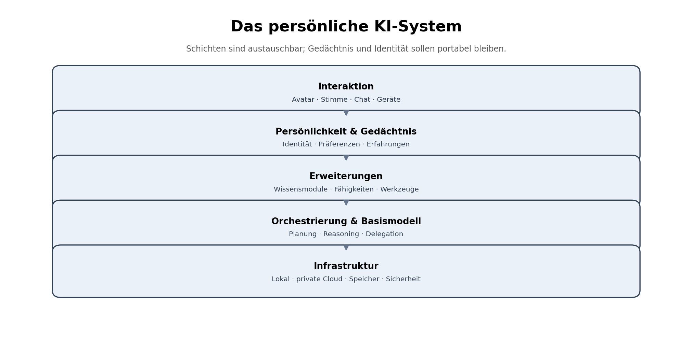

# 7. Technische Architektur: Personal AI Operating System

Die Plattform könnte als persönliches KI-Betriebssystem (PAIOS) gestaltet werden.

## Architekturschichten

1. **Infrastruktur:** lokale Hardware, Cloud, Speicher, Sicherheit.
2. **Intelligenz:** Basismodell, Reasoning, Agenten und Entscheidungslogik.
3. **Orchestrierung:** Planung, Delegation und Kommunikation mit externen KIs.
4. **Erweiterungen:** Wissensmodule, Werkzeuge, Fachmodelle.
5. **Persönlichkeit und Gedächtnis:** Identität, Präferenzen, Langzeitgedächtnis.
6. **Interaktion:** Avatar, Stimme, Chat, Sprache und Geräte.

## Kommunikationsstandard

Ein offener Standard sollte definieren:
- Fähigkeitsbeschreibungen und Auffindbarkeit
- Struktur von Anfragen und Antworten
- Quellen- und Herkunftsnachweise
- Identitäten und Berechtigungen
- Datenschutz und Datenminimierung
- Preise, Lizenzen und Abrechnung
- Fehlerbehandlung und Vertrauenssignale

Das Internet ist ein nützliches Vorbild: Unterschiedliche Systeme können kooperieren, wenn sie gemeinsame Protokolle verwenden.
